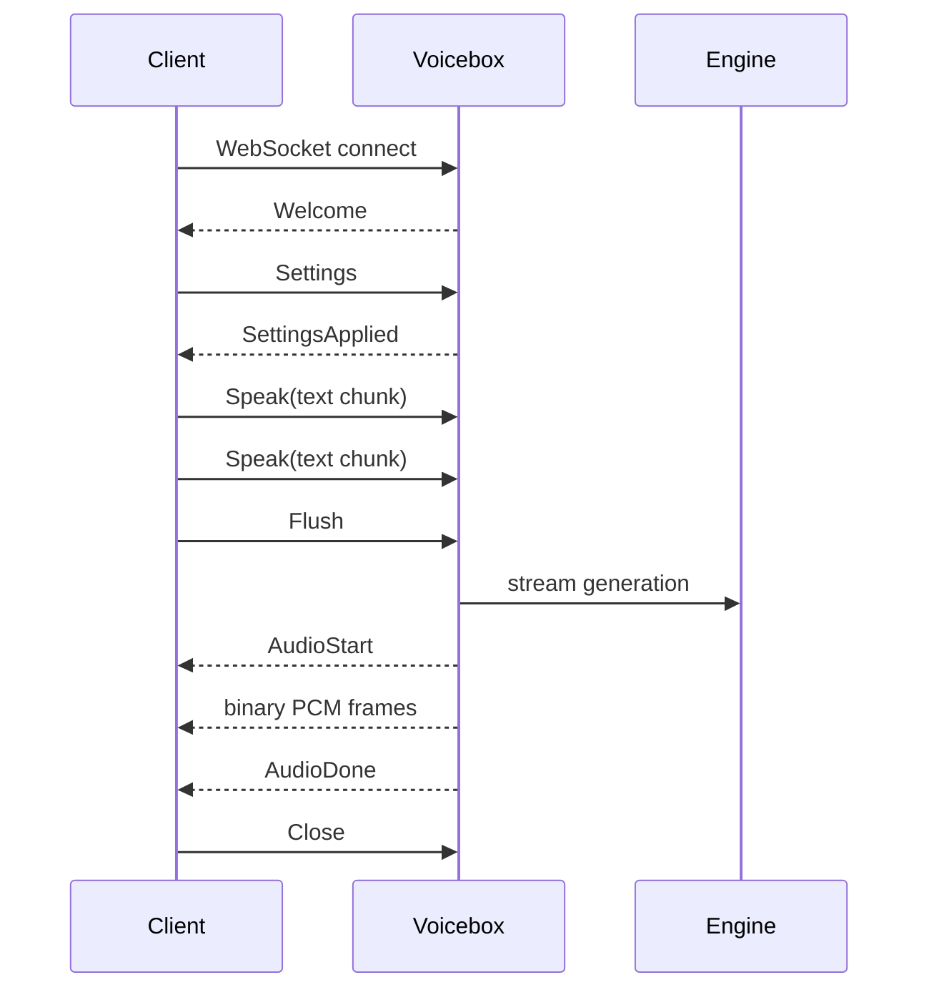

# Streaming TTS Protocol PRD

**Status:** Proposed
**Last reviewed:** 2026-06-27
**Owner:** TBD
**Touches:** backend, frontend playback, MCP/agent integrations, docs

## Summary

Voicebox should add a first-class realtime text-to-speech streaming protocol
modeled on the practical shape of Deepgram's streaming TTS and Voice Agent
APIs: one WebSocket session, JSON control messages, binary PCM audio frames,
explicit interruption semantics, and measurable time-to-first-audio.

The target protocol is **WebSocket binary PCM**, not HTTP chunked WAV. HTTP
streaming can remain as a compatibility endpoint for simple clients, but it is
not sufficient for low-latency agent speech, browser playback, interruption, or
animation-driven clients like Puter Face.

## Problem

Voicebox's current generation contract is file-oriented: submit text, wait for
the generation to complete, then play or fetch the resulting audio. That works
for studio workflows, but it is the wrong interaction model for agents and
realtime UI:

- users should hear speech as soon as the model emits usable audio
- LLM text should be streamable into TTS without waiting for the full response
- callers need `Flush`, `Clear`, and `Close` controls
- barge-in/interruption must stop pending audio quickly
- browser clients need raw PCM frames they can feed into an AudioWorklet
- animation clients need timing/event hooks tied to audio output

The current HTTP chunked WAV prototype is useful as a compatibility experiment,
but WAV is a poor live protocol because the format normally wants final byte
sizes, browsers vary in streaming WAV behavior, and there is no clean channel
for control frames, interruption acknowledgements, or timing metadata.

## Goals

- Provide a vendor-parity streaming TTS API inspired by Deepgram's TTS WebSocket
  controls and Voice Agent message flow.
- Reduce warm-model time-to-first-audio for streaming-capable engines.
- Support incremental LLM output via repeated `Speak` messages plus `Flush`.
- Support low-latency interruption via `Clear`.
- Stream raw PCM audio as binary WebSocket frames.
- Keep existing `POST /generate` and file/history workflows intact.
- Expose enough session events for UI playback, agent status, and future facial
  animation.
- Make fallback behavior explicit when an engine cannot truly stream.

## Non-goals

- Full duplex voice agent orchestration in this PRD. This feature is TTS output
  first, though the protocol should not block a later STT/agent loop.
- WebRTC transport in the first implementation. WebRTC is a better fit for
  wide-area duplex media, but it is too much surface for the first local TTS
  streaming release.
- SSE-based audio streaming. SSE is text/event oriented and unsuitable for
  binary PCM audio.
- Browser `decodeAudioData()` playback as the primary client path. It normally
  expects complete buffers; low-latency playback needs a streaming PCM path.
- Replacing existing history, Stories, or offline generation flows.

## Deepgram Parity Targets

Deepgram's current streaming TTS and Voice Agent docs establish the parity bar:

- Streaming TTS uses WebSockets for streaming text into audio.
- TTS control messages include `Speak`, `Flush`, `Clear`, and `Close`.
- `Clear` stops newly emitted audio as soon as possible and returns a `Cleared`
  acknowledgement.
- For WebSocket TTS, `container=none` is the low-latency raw-audio shape.
- REST TTS can stream an audio response over chunked transfer encoding, but that
  is separate from the realtime WebSocket protocol.
- Voice Agent sessions use a handshake pattern: server `Welcome`, client
  `Settings`, server `SettingsApplied`, then binary PCM and JSON events.
- Voice Agent events include barge-in style signals such as
  `UserStartedSpeaking`, transcript/agent text events, binary audio frames, and
  `AgentAudioDone`.

Voicebox does not need to copy Deepgram names exactly, but matching these
semantics lets agent clients and browser demos reason about Voicebox the same
way they reason about modern streaming voice APIs.

## Users And Use Cases

### Agent developers

An agent streams LLM tokens to Voicebox and starts speaking before the full
response is available. If the user interrupts, the agent sends `Clear` and
starts a new response.

### Local app developers

A desktop app connects to Voicebox over localhost, sends text, and receives raw
PCM frames for immediate playback without writing files.

### Voicebox UI

The Generate tab can offer a "stream preview" path for engines that support it,
while retaining the existing persisted generation path for final renders.

### Puter Face and animation clients

The client consumes audio frames and timing events to drive idle motion,
speaking state, mouth motion, captions, and future expression/viseme controls.

## Proposed API

### Endpoint

Add a WebSocket endpoint:

```text
GET /generate/ws
```

The endpoint is loopback/local-app oriented and should use the same backend
model/profile resolution as `POST /generate` where practical.

Longer term, Voicebox may add a friendlier alias such as `GET /tts/stream`, but
the first implementation should stay close to the current generation API.

### Session Lifecycle



### Client Messages

All text frames are JSON objects with a required `type` field.

#### `Settings`

Configures the session. The server must not accept `Speak` until settings are
applied.

```json
{
  "type": "Settings",
  "session_id": "optional-client-session-id",
  "voice": {
    "profile_id": "uuid-or-null",
    "profile": "name-or-null",
    "engine": "qwen",
    "model_size": "1.7B",
    "language": "en",
    "seed": 42,
    "instruct": "warm and conversational"
  },
  "audio": {
    "encoding": "linear16",
    "sample_rate": 24000,
    "channels": 1,
    "container": "none"
  },
  "behavior": {
    "auto_flush": false,
    "persist_generation": false,
    "normalize": false,
    "effects_chain": null
  }
}
```

MVP constraints:

- `encoding` must be `linear16`.
- `channels` must be `1`.
- `container` must be `none`.
- `sample_rate` defaults to the backend sample rate if omitted.
- `normalize`, effects chains, trimming, and crossfades may force buffered mode
  until streaming-safe implementations exist.

#### `Speak`

Adds text to the current utterance buffer.

```json
{
  "type": "Speak",
  "utterance_id": "utt_123",
  "text": "Hello. I can start speaking before the whole response exists.",
  "flush": false
}
```

If `flush` is true, this is equivalent to sending `Speak` followed by `Flush`.

#### `Flush`

Forces generation from the current internal text buffer.

```json
{
  "type": "Flush",
  "utterance_id": "utt_123"
}
```

The server should acknowledge with `Flushed` once the buffered text has been
accepted for generation, not necessarily after all audio has been played.

#### `Clear`

Interrupts the active utterance, clears pending text/audio, and cancels queued
or running generation work as quickly as the backend safely allows.

```json
{
  "type": "Clear",
  "reason": "barge_in"
}
```

The server must respond with `Cleared`.

#### `Close`

Gracefully closes the session after the server releases resources.

```json
{
  "type": "Close"
}
```

### Server Messages

Server JSON events are text frames. Audio chunks are binary frames containing
little-endian signed 16-bit PCM.

#### `Welcome`

```json
{
  "type": "Welcome",
  "request_id": "uuid",
  "protocol": "voicebox.tts.v1"
}
```

#### `SettingsApplied`

```json
{
  "type": "SettingsApplied",
  "audio": {
    "encoding": "linear16",
    "sample_rate": 24000,
    "channels": 1,
    "container": "none"
  },
  "mode": "live"
}
```

`mode` is `live` when the selected backend yields incremental audio, and
`buffered` when Voicebox must synthesize the full waveform before sending PCM.

#### `AudioStart`

```json
{
  "type": "AudioStart",
  "utterance_id": "utt_123",
  "sequence_id": 1,
  "sample_rate": 24000,
  "channels": 1,
  "encoding": "linear16"
}
```

All following binary frames belong to the active utterance until `AudioDone`,
`Cleared`, or `Error`.

#### Binary Audio Frame

Binary WebSocket frame:

```text
PCM16 little-endian mono bytes
```

Frame boundaries are transport boundaries, not semantic audio boundaries. The
client should play frames in order and use `sample_rate` plus byte length to
derive time.

#### `AudioDone`

```json
{
  "type": "AudioDone",
  "utterance_id": "utt_123",
  "sequence_id": 1,
  "samples": 38112,
  "duration_ms": 1588
}
```

#### `Flushed`

```json
{
  "type": "Flushed",
  "utterance_id": "utt_123",
  "sequence_id": 1
}
```

#### `Cleared`

```json
{
  "type": "Cleared",
  "sequence_id": 1
}
```

#### `Metrics`

Optional but useful for local tuning and parity testing.

```json
{
  "type": "Metrics",
  "utterance_id": "utt_123",
  "time_to_first_audio_ms": 420,
  "generated_audio_ms": 1588,
  "mode": "live"
}
```

#### `Error`

```json
{
  "type": "Error",
  "code": "invalid_settings",
  "message": "encoding must be linear16 for v1"
}
```

## Functional Requirements

### MVP

- Add `GET /generate/ws` WebSocket endpoint.
- Implement `Welcome`, `Settings`, `SettingsApplied`, `Speak`, `Flush`,
  `Clear`, `Close`, `AudioStart`, binary audio frames, `AudioDone`, `Flushed`,
  `Cleared`, `Error`, and `Metrics`.
- Stream PCM16 little-endian mono audio.
- Reuse existing profile/engine/model resolution.
- Support at least one true streaming backend path.
- Provide explicit buffered fallback with `mode: "buffered"`.
- Cancel active/pending generation on `Clear`.
- Enforce origin/loopback safety for browser and agent clients.
- Include a minimal browser playback demo or docs example using AudioWorklet or
  an equivalent streaming PCM playback path.
- Add protocol docs and examples.

### P1

- Add an SDK-like TypeScript helper for browser/Tauri clients.
- Expose client-side audio-level events or examples so animation clients can
  derive mouth motion from PCM frames.
- Add optional caption/text events for generated utterances.
- Support `persist_generation: true` for callers that want streamed playback
  and history records.
- Support server-side chunk timing events with sample offsets.
- Add a CLI smoke-test client that prints TTFA and writes the streamed PCM/WAV.

### P2

- Add duplex voice-agent mode that accepts mic PCM and emits speech events.
- Add optional Opus output for networked clients.
- Add WebRTC transport if remote low-jitter duplex use cases become primary.
- Add richer animation events, such as phoneme/viseme estimates, if model output
  or downstream analysis can produce them reliably.

## Backend Architecture

### Backend Protocol Extension

Extend the TTS backend contract with an optional streaming method:

```python
class StreamingTTSBackend(Protocol):
    async def generate_stream(
        self,
        text: str,
        voice_prompt: dict,
        language: str = "en",
        seed: int | None = None,
        instruct: str | None = None,
        cancellation: CancellationToken | None = None,
    ) -> AsyncIterator[AudioChunk]: ...
```

`AudioChunk` should carry:

- `audio`: NumPy float array or PCM bytes
- `sample_rate`
- optional `is_final`
- optional `offset_samples`

The route layer owns PCM16 conversion so clients get one consistent wire format
across engines.

### Session Manager

Add a session object per WebSocket connection:

- stores settings and resolved voice profile
- buffers text until `Flush`
- serializes utterances for a single session
- owns cancellation token(s)
- emits JSON events and binary audio frames in order
- records TTFA and completion metrics

### Queueing

Voicebox already serializes generation to protect GPU resources. Streaming
sessions should use the same global resource discipline, but interruption must
be able to cancel queued work before it starts and signal running backends to
stop when supported.

### Fallback Behavior

If a selected engine cannot stream:

- accept the same WebSocket protocol
- emit `SettingsApplied` with `mode: "buffered"`
- generate the full audio internally
- send `AudioStart`, binary PCM frames, and `AudioDone`
- keep `Clear` meaningful for queued work and unsent output

This keeps client code stable while making performance differences explicit.

## Frontend And Playback

The browser/Tauri client should not rely on `<audio>` tags for the main
streaming path. It should feed PCM frames into:

- an `AudioWorklet` ring buffer, preferred
- or a proven local streaming PCM abstraction if one already exists in the app

The client should:

- wait for `SettingsApplied` before sending `Speak`
- start playback on `AudioStart` plus first binary frame
- stop playback immediately on local interruption and send `Clear`
- drop any buffered local audio after `Cleared`
- compute local audio level from PCM frames for animation if no server-side
  level events exist yet

## Security And Privacy Requirements

- Default binding remains localhost only.
- Validate WebSocket `Origin` against known local/Tauri origins.
- Reject non-loopback hosts unless a user explicitly enables remote mode.
- Do not allow arbitrary web pages to connect to local Voicebox and synthesize
  speech.
- Define max JSON message size and max buffered text size.
- Rate-limit connection attempts enough to prevent local abuse.
- Treat malformed JSON as a protocol error and close cleanly.
- Ensure `Clear` and disconnect cleanup release backend resources.
- Do not log full user text by default in debug/error logs.

## Performance Requirements

Initial targets for a warm model and a streaming-capable backend:

- time from accepted `Flush` to first binary audio frame: under 1 second
- `Clear` acknowledgement: under 100 ms when queued or between chunks
- stop sending further audio after `Clear`: under 250 ms when backend supports
  cooperative cancellation
- no unbounded memory growth for long streams or slow clients

Metrics should be emitted per utterance so these targets can be measured in
tests and demos.

## Test Plan

### Unit Tests

- message parsing and validation
- settings negotiation defaults
- PCM16 conversion, including negative sample scaling
- text buffer behavior for `Speak` plus `Flush`
- `Clear` clears pending text and pending audio
- malformed JSON and unknown message handling
- max message/text limits

### Integration Tests

- fake streaming backend emits multiple chunks and server forwards binary frames
- fake buffered backend emits `mode: "buffered"` and still follows the protocol
- client disconnect cancels pending generation
- `Clear` during queued generation prevents backend execution
- `Clear` during live generation stops forwarding further chunks
- event ordering: `AudioStart` before audio frames, `AudioDone` after frames
- security: disallowed `Origin` is rejected

### Browser/Playback Tests

- Playwright smoke test opens demo page, connects to local backend, receives
  audio frames, and confirms nonzero playback buffer activity.
- Interruption test sends `Clear` and verifies the local playback buffer drains.

### Manual Real-Model Tests

- warm-model TTFA measurement for the first streaming engine
- long response from simulated LLM token stream
- barge-in with rapid `Clear` plus new `Speak`
- resource cleanup after repeated connect/disconnect cycles

## Rollout Plan

1. Land this PRD and protocol examples.
2. Add backend WebSocket protocol with a fake streaming backend test harness.
3. Wire one real engine into `generate_stream()` with cooperative cancellation.
4. Add browser/Tauri playback demo and local TTFA instrumentation.
5. Harden origin checks, limits, cancellation, and disconnect cleanup.
6. Update developer docs and examples.
7. Only then consider an upstream PR for Voicebox.

## Acceptance Criteria

- A local client can connect to `GET /generate/ws`, send `Settings`, send
  `Speak` and `Flush`, and hear PCM audio before the full utterance is complete
  for at least one streaming-capable engine.
- The same client can send `Clear` during playback and receive `Cleared` while
  no stale audio from the interrupted utterance continues to play.
- Non-streaming engines still work through the same WebSocket API with
  `mode: "buffered"`.
- Automated tests cover protocol parsing, fake live streaming, fake buffered
  fallback, cancellation, and origin rejection.
- Docs include protocol examples and a clear statement that HTTP chunked WAV is
  compatibility-only, not the primary realtime protocol.

## Risks

- Some upstream model APIs may not expose meaningful audio chunks; they may only
  produce complete waveforms.
- Cooperative cancellation can be partial if the model generation loop does not
  yield frequently.
- Browser PCM playback requires careful buffering to avoid under-runs, drift,
  and clicks.
- WebSocket flow control must prevent slow clients from accumulating unbounded
  audio in memory.
- Supporting effects, normalize, trim, and crossfade in live mode may require
  streaming-safe rewrites rather than reusing existing whole-file processors.
- Local WebSocket security matters: without origin checks, any browser page
  could potentially drive local speech.

## Open Questions

- Should `Settings` be mandatory for TTS-only sessions, or should query params
  cover simple clients?
- Should the first endpoint be `GET /generate/ws`, `GET /tts/stream`, or both?
- Should binary frames be raw PCM only, or should we support a tiny custom frame
  header for chunk metadata?
- What is the first engine we can test with real streaming and real
  cancellation on Nate's machine?
- Should persisted streamed generations be MVP or follow-up?
- Should Puter Face consume only PCM-derived levels first, or do we add explicit
  animation/timeline events in v1?

## References

- Deepgram Streaming Text-to-Speech:
  https://developers.deepgram.com/docs/streaming-text-to-speech
- Deepgram TTS `Clear` control:
  https://developers.deepgram.com/docs/tts-ws-clear
- Deepgram TTS `Flush` control:
  https://developers.deepgram.com/docs/tts-ws-flush
- Deepgram TTS `Close` control:
  https://developers.deepgram.com/docs/tts-ws-close
- Deepgram TTS container setting:
  https://developers.deepgram.com/docs/tts-container
- Deepgram Voice Agent message flow:
  https://developers.deepgram.com/docs/voice-agent-message-flow
